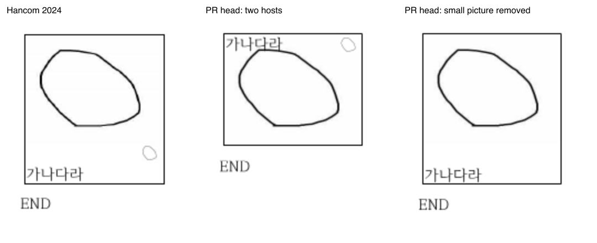
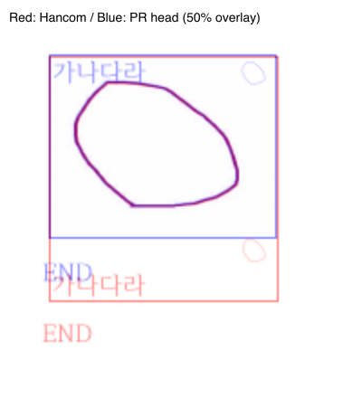

# PR #9022 그림 호스트 교체 재현

2026-11-14 KST. 검토 코드: `4cf97fe5f40bde52b6e80dfc461b5111b51139b6`.

## 결론

실제 HWPX를 파싱하고 Native Skia Print PNG와 render tree를 생성했을 때,
작은 그림을 가진 둘째 문단이 있으면 뒤 글 `가나다라`가 앞의 큰 그림 영역 안에 놓인다.
작은 그림만 제거한 대조군에서는 뒤 글이 큰 그림 아래로 내려간다.
같은 재현물을 연 독립 한컴 2024 PDF에서도 뒤 글은 두 그림 아래에 있다.
그림의 외곽 상자와 글 상자의 겹침을 확인한 것이며, 검은 획끼리의 접촉을 뜻하지 않는다.

이는 이전 리뷰의 코드 검토상 우려를 문서 실행 증거로 보완한다. base 빌드와 비교하지
않았으므로 이 PR에서 새로 생긴 회귀라고 단정하지 않는다. 이 PR의 새 회피 로직에 남은
경계 결함이며, 영구 회귀 테스트나 정상 golden을 등록하는 변경이 아니다.

## 입력 생성

`source.hwpx`는 검토 head의 `samples/issue8695/cell-caption-below-single-picture.hwpx`와
바이트가 같다. 공개 합성 재현물이며 실사용자의 문서가 아니다.

`python3 generate.py`로 두 문서를 만든다. 원본 셀 정렬을 TOP으로 바꾸고, 큰 그림 문단을
복제해 둘째 문단을 추가한다. 둘째 그림의 크기를 1200×1200HU, 가로 오프셋을 7800HU로
설정하고 개체·문단 ID를 바꾼다. 저장 LineSeg는 제거한다. 대조군은 같은 둘째 문단에서
그림 개체만 제거한다. 원본에 없던 저장 줄 메타데이터를 추가하지 않았다.

## 실행 환경과 명령

공용 Cargo target에서 `cargo build --locked --profile release-test --features native-skia --bin rhwp`로
원본 PR head를 빌드했다. 작업 소스의 라이브러리 컴파일을 로그에서 확인했다.
빌드한 실행 파일 SHA-256:
`845bb4b3aece08e44648724deb3e41231d12747d9e26eb4ce097d64af043f2f2`.

저장소 루트에서 실제 입력·출력 위치에 맞게 경로를 지정한다.

```sh
rhwp export-png two-hosts.hwpx --compat 2024 --dpi 96 --profile print   --font-path ttfs/opensource --render-tree-output two-hosts-native/tree   -o two-hosts-native --json
```

`source.hwpx`, `blank-second-host.hwpx`도 같은 명령으로 실행했다.
`two-hosts.hwpx`는 `--compat 2022`로도 반복해 같은 글 위치를 확인했다.
실제 Native 글꼴 공급은 CLI의 native-webfont 경로로 HCR Batang/HCR Dotum을 로드했다.
font environment ID: `native-webfont-1424bc862e94d20a66e207ed`.

독립 PDF: 한컴 2024 `13.0.0.3901`, `hwp-managed-direct-dll-host`,
`frame_print_to_pdf_ex_one_up`, 입력 전처리 없음, PDF 1쪽.
변환 job: `55bf659d-0e75-4b52-b199-47ab928c1a57`.
`pdftoppm -f 1 -singlefile -r 96 -png two-hosts-hancom.pdf hancom`으로 이미지화했다.

## 실제 출력 관측

좌표는 96 DPI, render tree가 소수 첫째 자리로 내보낸 값이다. 모든 문서는 1쪽이다.

| 입력 | 큰 그림 y..bottom | 뒤 글 y..bottom | END y | 관측 |
| --- | --- | --- | --- | --- |
| 원본 source | 137.9..235.2 | 235.2..248.5 | 262.2 | 그림 아래 |
| two-hosts | 137.9..235.2 | 137.9..151.2 | 248.9 | 큰 그림 내부 |
| blank-second-host | 137.9..235.2 | 256.6..269.9 | 283.6 | 그림 아래 |

두 그림 문서의 큰 그림 x..right는 119.0..241.0, 작은 그림은 223.0..239.0,
글은 119.0..170.8이다. 글은 작은 그림과 가로로 겹치지 않지만 큰 그림과는 겹친다.
따라서 작은 그림만 보고 판정하면 앞 그림을 피할 수 없다.
한컴 PDF의 글 glyph bbox yMin은 192.522800pt(96 DPI 환산 256.697px)이며,
직접 판독에서도 큰 그림 아래에 작은 그림과 글이 차례로 놓인다. PDF glyph bbox와
rhwp line bbox는 다른 메트릭이므로 수치의 완전 일치를 주장하지 않는다.

`CellSquareStackTextFloor::paragraph_top`의 `self.host = Some(...)`는 둘째 호스트를
만나면 첫 호스트를 교체하고 반환한다. 이후 `CellSquareFirstLine::top`에는 마지막 호스트의
상자만 전달된다. 위 대조군은 그 상태 교체 조건을 그림 개체의 유무로 가른다.

## 직접 판독





비교 그림은 원본 96 DPI의 같은 영역을 2배로 표시한다. overlay도 같은 페이지 좌표를
사용한다. 그림 뒤의 글, 표 아래 경계, END 문단의 상향 이동이 보인다.

## 검증 한계

Native 실제 파일 실행과 독립 한컴 PDF 비교를 수행했다. fresh WASM, 전체 회귀,
전쪽 Visual Sweep TSV 점수와 base/head 회귀 비교는 수행하지 않았다. 시각 gate 통과나
한컴과의 전체 일치를 주장하지 않는다. 입력·PDF·출력 해시는 `sha256.json`에 있다.
