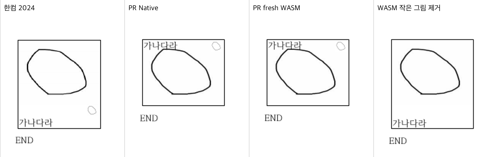
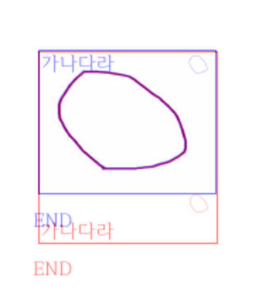

# PR #9022 fresh WASM 추가 재현

2026-11-14 KST. **동일 HWPX에서 Native와 같은 결함을 직접 재현했다.**
기존 [Native·한컴 재현 기록](../README.md)의 fresh WASM 미실행 항목을 보완한다.

## 빌드와 실행

- 코드 head: `4cf97fe5f40bde52b6e80dfc461b5111b51139b6`. 이 SHA를 checkout한 상태에서 빌드했다.
- Rust `1.93.1 (01f6ddf75 2026-02-11)`, wasm-pack `0.15.0`, Node `v24.15.0`.
- Docker daemon을 사용할 수 없어 호스트의 locked wrapper를 사용했다. 공용 review target,
  `CARGO_BUILD_JOBS=6`, 기본 release 설정으로 빌드했으며 `--no-opt`는 사용하지 않았다.
- Cargo release 11분 6초, 이후 wasm-bindgen과 wasm-opt·패키징까지 종료 코드 0.
  [빌드 로그](build.txt), [해시·실행 조건](provenance.json).
- `pkg/rhwp.js`·`pkg/rhwp_bg.wasm`과 `rhwp-studio/public/`의 동명 파일은 바이트가 같았다.
- 브라우저: `Chrome/157.0.8103.51`, headless Chromium의 실제 Print Canvas2D.
  `scripts/export-wasm-png-for-sweep.mjs`로 PNG와 render tree를 추출했다.
  이 하네스는 검토 head와 기본 작업공간 사이에 변경이 없는 파일이다.
- 한컴 2024 호환, 96 DPI, `print`, 전체 페이지, worker 1. 세 입력 모두 1쪽.
- `ttfs/opensource`와 저장소 웹폰트 공급 규칙의 `HANBatang.woff`를 사용했다.
  `font_catalog`로 WOFF를 SFNT로 변환하고 `HCR Batang`·`함초롬바탕` FontFace의 실제
  로드와 공급 프로그램 해시를 export metadata에서 확인했다. 글꼴 파일은 재배포하지 않았다.
- 최초 진단은 함초롬바탕의 명시적 로드가 없어 최종 증거에서 제외하고,
  위 공급 조건으로 세 입력을 다시 실행했다. 아래 PNG·TSV·JSON은 모두 최종 실행이다.

```sh
CARGO_TARGET_DIR=<shared-review-target> CARGO_BUILD_JOBS=6 \
  scripts/wasm-pack-locked.sh --target web --out-dir pkg

node scripts/export-wasm-png-for-sweep.mjs \
  --pkg <fresh-pkg> --input <same-input.hwpx> --out <output> \
  --fonts <font-catalog.json> --options <canvas-options.json>

python scripts/visual_sweep.py --silhouette-only \
  --png-pair <wasm-output/rhwp_png> <hancom-pdf-png-directory> --out <score-output>
```

Canvas options는 `pages:null`, `workers:1`, `scale:1`, `compat:"2024"`,
`fontEnvironment:null`이다. Python 실행 경로는 해당 환경을 지정한다.
입력은 이전 증거 commit `0f0ea7854dbf8a3fbb31e89951a4c5f8465f6621`의
[source.hwpx](../source.hwpx), [two-hosts.hwpx](../two-hosts.hwpx),
[blank-second-host.hwpx](../blank-second-host.hwpx)와 SHA-256이 같다.
한컴 PDF도 [기존 동일 입력의 독립 출력](../two-hosts-hancom.pdf)을 그대로 사용했다.

## 실행 관측과 코드 해석의 구분

**직접 실행 관측:** 아래 값은 render tree가 소수 첫째 자리로 내보낸 96 DPI 좌표다.
Native는 기존 실행, WASM은 이번 fresh package 실행이다. 세 입력에서 두 backend의 해당 값은 같다.

| 입력 | 큰 그림 y..bottom | 뒤 글 y..bottom | END y | 관측 |
| --- | --- | --- | --- | --- |
| source | 137.9..235.2 | 235.2..248.5 | 262.2 | 그림 아래 |
| two-hosts | 137.9..235.2 | 137.9..151.2 | 248.9 | 큰 그림 영역 내부 |
| blank-second-host | 137.9..235.2 | 256.6..269.9 | 283.6 | 그림 아래 |

큰 그림은 x=119.0..241.0, 작은 그림은 x=223.0..239.0, 뒤 글은 x=119.0..170.8이다.
뒤 글은 작은 그림과 가로로 겹치지 않지만 큰 그림과 겹친다. 그림 상자와 글 상자의 겹침이며
검은 획끼리의 접촉을 주장하지 않는다. 실제 PNG에서도 같은 영역과 표 아래 경계·END의
상향 이동을 직접 확인했다. 한컴은 큰 그림 아래에 작은 그림과 글이 이어진다.

**코드 해석:** `CellSquareStackTextFloor::paragraph_top`의 `self.host = Some(...)`가
둘째 그림 호스트에서 앞 호스트를 대체하고, 후속 글의 회피 판정에는 마지막 호스트 상자만
남는 경로와 관측이 일치한다. 이 해석은 실제 문서 실행과 그림만 제거한 대조군으로 보강된다.
상태 값을 런타임 계측한 것은 아니며, base를 빌드하지 않아 PR이 새로 도입한 회귀라고 단정하지 않는다.

## 전쪽 실루엣과 직접 판독

같은 two-hosts HWPX에 대응하는 독립 한컴 2024 PDF 1쪽과 비교했다.
기존 PDF의 96 DPI Poppler PNG를 재사용했고 페이지 정렬이나 영역 제외는 하지 않았다.

| 경로 | 전체 쪽수 | 최소 silhouette_raw_match_percent | 판정 |
| --- | --- | --- | --- |
| Native | 1 | 61.84 | 90% 미만 |
| fresh WASM | 1 | 62.16 | 90% 미만 |

[Native 전쪽 TSV](native-silhouette.tsv), [fresh WASM 전쪽 TSV](wasm-silhouette.tsv).
`re_review_required`이며 기존 변경 요청을 유지한다. 측정 명령의 비정상 종료는 90% 미달
판정에 따른 것이며, 세 문서의 Canvas export는 모두 정상 완료했다. 이 점수는 전체 fidelity
통과를 뜻하지 않는다. 대조군·원본의 별도 한컴 PDF 일치 점수는 이번 범위에 포함하지 않았다.





같은 96 DPI 좌표의 영역을 2배 확대했다. 라벨과 본문을 구분해 직접 판독했다.
원본 PNG와 render tree 및 실제 font/browser metadata도 이 폴더에 보존했다.

## 검증 범위

이번 작업은 이미 제기한 경계 결함의 fresh WASM 재현 보완이다. 전체 회귀·편람 gate·base/head
비교를 새로 실행한 종합 승인 검토가 아니며, 정상 golden이나 영구 회귀 검사를 등록하지 않았다.
브라우저 Print Canvas를 직접 실행했으며 Studio 전체 편집 UI 여정을 검증한 것은 아니다.
